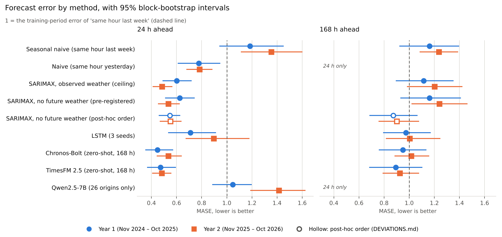

# Forecasting hourly electricity demand in Northern Virginia: classic models, deep learning, foundation models and an LLM on one backtest

A pre-registered two-year backtest on hourly demand in Dominion Energy's zone of PJM, the grid region that serves the Northern Virginia data-center cluster. Every method gets the same 104 weekly forecast origins, the same horizons (24 h and 168 h) and the same scoring code.

## Summary

- **Day-ahead:** two time-series foundation models were never trained on this zone and saw only one week of history. They still matched or beat a SARIMAX trained on years of it.
  - TimesFM 2.5 beat SARIMAX without future weather in both test years.
  - Chronos-Bolt beat it in the first year and tied in the most recent.
  - Against the post-hoc SARIMAX order the day-ahead edge narrows: TimesFM is better in year 2 only (−0.070 [−0.123, −0.015]) and ties in year 1; Chronos-Bolt is better in year 1 only (−0.098 [−0.168, −0.010]) and ties in year 2.
- **Week-ahead:** the result depends on one modelling choice in SARIMAX, its differencing order.
  - As pre-registered, SARIMAX was no better than "same hour last week", and both foundation models beat it.
  - With the order that unit-root tests on its residuals support, chosen after the first results and labelled as post-hoc, SARIMAX without future weather is level with TimesFM in both years (+0.022 and +0.023, intervals spanning zero) and ahead of Chronos-Bolt at the headline context (+0.077 and +0.115, intervals excluding zero); with 2,048 h of context Chronos-Bolt is level with it too.
  - So this study shows no week-ahead advantage for the foundation models over a well-specified SARIMAX.
- **A general LLM** (Qwen2.5-7B, 4-bit, run locally) did worse than repeating yesterday's load. Its 80% ranges covered about 40% of outcomes, where a perfectly calibrated model with 5 samples would reach about 67%.
- **More history** (2,048 h instead of 168 h) helped Chronos-Bolt in the most recent year, and did not help TimesFM.

I built this to learn how modern forecasting methods compare with a classic statistical model when all of them face the same honest backtest: fixed origins, no look-ahead, intervals checked and every change after the results logged.

**Credit where it is due.** Zero-shot foundation models have been benchmarked on electricity load before, for example on ERCOT by Simeone (2026), and the LLM arm follows LLMTime (Gruver et al., 2023). This study adds:
- a pre-registered comparison on the Dominion zone over the two most recent years, reported separately;
- a SARIMAX comparison that is fair to the foundation models (no future weather);
- interval coverage for every method;
- a public record of what changed after the first results.

## The question

How well do classic, deep-learning, foundation-model and general-LLM forecasts track hourly demand in the Dominion zone? Does any of them hold up better in the most recent year? And are their prediction intervals honest?

Data centers are not metered separately in this data. The study can show how well forecasts track a growing zone. It cannot say how much of the growth, or of any forecast error, comes from data centers.

## Data

- **Demand:**
  - EIA Form 930 hourly demand for PJM's Dominion subregion (DOM), from the Catalyst Cooperative PUDL release v2026.11.0, pinned by file hash.
  - Training history starts 2019-01-01; 2018 is excluded because 39% of its hours are missing.
  - Licence: CC-BY-4.0 (Catalyst Cooperative). PUDL's versioned data releases are archived on Zenodo under concept DOI 10.5281/zenodo.3653158; the file used here is pinned by its SHA-256 hash in DATA_SOURCES.md.
- **Weather:** hourly 2 m temperature from Open-Meteo's historical weather API (ERA5-based), at Ashburn (39.04, −77.49), Richmond (37.54, −77.44) and Norfolk (36.85, −76.29), averaged with fixed weights of 1/3 each. API data under CC BY 4.0 — weather data by Open-Meteo.com.
- **Missing and flagged hours:**
  - Model inputs replace a flagged or missing hour with the value 168 hours earlier, a fill that only looks backwards.
  - Scoring uses reported values on unflagged hours only. 98 of 8,903 target hours were dropped in year 1 and 23 of 8,567 in year 2, the same hours for every method.
  - PUDL's imputed series is not used: it imputes each year as a whole, which would leak later information into a backtest.

## Design

**Plan.** PLAN.md was committed before any model saw the test period. Every later change is in DEVIATIONS.md, and the results show both versions.

**Test period and origins.**
- The test period runs 2024-11-01 to 2026-10-31, in two halves:
  - year 1: November 2024 – October 2025, 53 origins;
  - year 2: November 2025 – October 2026, 51 origins.
- Origins are weekly at 00:00 US Eastern; horizons are 24 h and 168 h.
- Classic models and the LSTM are refitted every 13 weeks on all data before the refit date. No model sees data after its origin.

**Score: MASE.** Absolute error divided by one fixed scale for all methods: the training-period error of "same hour last week" (1,329.73 MW). Below 1 means better than that benchmark did on the training years. 95% intervals come from a block bootstrap over origins (blocks of 4). MAPE, peak-hour error, 80% interval coverage and the Winkler score are in `results/`.

**Methods.**

| Method | Trained on this zone? | History it sees at each origin |
|---|---|---|
| Seasonal naive (same hour last week) | No | 1 week |
| Naive (same hour yesterday), 24 h only | No | 1 day |
| SARIMAX with Fourier terms, degree-hours and holidays: (a) observed future temperature, an upper bound no real forecaster has; (b) no future weather — over the horizon it uses the temperature from 168 hours earlier (the same hour last week) in the degree-hour terms; the two variants share each refit's fitted parameters and differ only in that temperature | Yes, refitted every 13 weeks | All history from 2019 |
| LSTM, 3 seeds — one layer, 64 hidden units; quantile (pinball) loss at the 10/50/90 quantiles; the point forecast is the seed-averaged median and the interval the seed-averaged 10–90% band | Yes, retrained every 13 weeks | Past 168 h plus calendar and temperature |
| Chronos-Bolt base (zero-shot) | No | 168 h (variant: 2,048 h) |
| TimesFM 2.5-200M (zero-shot) | No | 168 h (variant: 2,048 h) |
| Qwen2.5-7B-Instruct, 4-bit, LLMTime-style (26 origins, 24 h only, 5 samples) | No | 168 h as text |

**Fair comparison.** The foundation models had no weather input. So the fair SARIMAX comparison is the variant without future weather; the observed-weather variant is reported as a ceiling.

## Results

### Day-ahead (24 h), MASE year 1 / year 2 (lower is better)

| Method | MASE | 80% coverage |
|---|---|---|
| Seasonal naive | 1.185 / 1.354 | 0.76 / 0.67 |
| Naive (yesterday) | 0.776 / 0.782 | 0.74 / 0.72 |
| SARIMAX, no future weather, pre-registered order | 0.626 / 0.534 | 0.68 / 0.80 |
| SARIMAX, no future weather, post-hoc order | 0.546 / 0.552 | 0.70 / 0.78 |
| SARIMAX, observed weather (ceiling), pre-registered | 0.602 / 0.484 | 0.71 / 0.84 |
| LSTM (3 seeds) | 0.711 / 0.896 | 0.90 / 0.88 |
| Chronos-Bolt | 0.448 / 0.535 | 0.79 / 0.76 |
| TimesFM 2.5 | 0.472 / 0.482 | 0.83 / 0.84 |
| Qwen2.5-7B (26 origins) | 1.048 / 1.415 | 0.38 / 0.41 |

### Week-ahead (168 h)

| Method | MASE | 80% coverage |
|---|---|---|
| Seasonal naive | 1.162 / 1.236 | 0.76 / 0.73 |
| SARIMAX, no future weather, pre-registered order | 1.162 / 1.240 | 0.78 / 0.81 |
| SARIMAX, no future weather, post-hoc order | 0.872 / 0.902 | 0.68 / 0.72 |
| SARIMAX, observed weather (ceiling), pre-registered | 1.115 / 1.202 | 0.80 / 0.81 |
| LSTM (3 seeds) | 0.974 / 1.004 | 0.81 / 0.86 |
| Chronos-Bolt | 0.949 / 1.016 | 0.59 / 0.64 |
| TimesFM 2.5 | 0.894 / 0.925 | 0.75 / 0.77 |

### What the paired comparisons support

These are paired MASE differences across the same origins, with 95% block-bootstrap intervals. A claim is made only where the interval excludes zero.

**Against the pre-registered SARIMAX without future weather:**
- TimesFM is better in every case:
  - day-ahead −0.153 [−0.201, −0.113] in year 1 and −0.052 [−0.089, −0.016] in year 2;
  - week-ahead −0.269 and −0.315.
- Chronos-Bolt is better everywhere except day-ahead in year 2, a tie at +0.001 [−0.052, +0.045].

**Against the post-hoc SARIMAX order:**
- TimesFM: day-ahead −0.074 [−0.138, +0.008] in year 1 (a tie) and −0.070 [−0.123, −0.015] in year 2 (better); week-ahead +0.022 [−0.032, +0.075] and +0.023 [−0.022, +0.066], ties in both years. At 2,048 h context all four of its differences against the post-hoc order span zero.
- Chronos-Bolt: day-ahead −0.098 [−0.168, −0.010] in year 1 (better) and −0.017 [−0.087, +0.056] in year 2 (a tie); week-ahead +0.077 [+0.010, +0.142] and +0.115 [+0.027, +0.202], so the post-hoc SARIMAX is better at the headline context. At 2,048 h context its week-ahead differences span zero (+0.032 and +0.019), and day-ahead in year 2 it is better (−0.110 [−0.181, −0.047]).
- The post-hoc SARIMAX itself beats seasonal naive in all four cells — week-ahead −0.290 [−0.352, −0.225] and −0.335 [−0.426, −0.242], where the pre-registered order's differences were +0.000 and +0.003.

**Other pairs:**
- TimesFM and Chronos-Bolt cannot be told apart, except week-ahead in year 2, where TimesFM is better (−0.092 [−0.171, −0.012]).
- The LSTM cannot be told apart from "same hour yesterday" at 24 h.

**Year 1 versus year 2.** No method's error changed between the two years by more than the intervals allow us to say.

### Why the SARIMAX week-ahead result moved

**The flaw.** The pre-registered plan chose SARIMAX's order by AIC across candidates with different differencing orders, and AIC cannot compare those. This was caught in the review of the first results.

**The fix.** The differencing was then chosen by unit-root tests on the regression residuals, using training data only. The tests disagreed:
- Canova–Hansen called for a seasonal difference;
- OCSB and the forecast package's seasonal-strength rule (0.595 against its 0.64 threshold) did not.

**The decision.** Canova–Hansen was followed, for reasons recorded in DEVIATIONS.md, and the call was made before the sensitivity's results existed. The resulting order (d = 0, D = 1) moves SARIMAX's week-ahead MASE from 1.16 / 1.24 to 0.87 / 0.90.

An earlier alternative with no differencing at all, (0, 0), did worse than the pre-registered order (DEVIATIONS.md).

The post-hoc order was confirmed with fully converged fits; it beats the runner-up by 779 AIC points. The same audit found that six of the eight pre-registered selection fits had stopped at statsmodels' default 50-iteration cap. The selected pre-registered fit was not one of them, and the pre-registered result stands as run.

So the plain reading is that SARIMAX's week-ahead accuracy here depends more on its differencing order than on any other choice in this study.

### Prediction intervals

- **Day-ahead:** the foundation models' 80% intervals are within about 0.05 of target, TimesFM slightly wide and Chronos-Bolt slightly narrow. SARIMAX without future weather under-covered in year 1 (0.68), and the LSTM's are too wide (0.90 / 0.88).
- **Week-ahead:** Chronos-Bolt's are too narrow, at 0.59 / 0.64, and 0.63 / 0.68 with 2,048 h of history. TimesFM, the pre-registered SARIMAX and the LSTM are within about 0.06 of target; the post-hoc order's week-ahead intervals under-cover, at 0.68 / 0.72.
- The LLM's ranges, the minimum to maximum of 5 samples, would cover about 67% of outcomes if perfectly calibrated. They covered 38–41%.

### More history for the foundation models (in-plan variant)

These are paired differences, 2,048 h − 168 h of context.

- **Chronos-Bolt improved in year 2** at both horizons:
  - day-ahead −0.093 [−0.161, −0.037];
  - week-ahead −0.096 [−0.165, −0.026].
- **Year 1** differences for Chronos-Bolt span zero.
- **TimesFM** was worse only day-ahead in year 1 (+0.063 [+0.013, +0.119]); its other differences span zero.

The headline uses 168 h, matched to the LLM as pre-registered. No "best context per model" figure is reported, because picking one per model after seeing test scores would be selection on the test set.

## What this does not show

- **One zone and one target:** Dominion's EIA-930 demand. Other zones may differ.
- **No data-center attribution:** data-center load is not separated, so nothing here attributes growth or error to data centers.
- **No real weather forecasts:** the observed-weather SARIMAX is a ceiling. The no-future variant uses the temperature from 168 hours earlier over the horizon.
- **Zero-shot foundation models only:** no fine-tuning, at the context lengths above.
- **Pretraining overlap:**
  - TimesFM 2.5 was released on 2025-09-15, during year 1. Its documented training data all predate the test period, and year 2 is the strictly clean comparison.
  - Chronos-Bolt was public by 2024-12-02.
- **A reduced LLM test:** one 7B model at 4-bit, 26 origins, 24 h only. The LLM result is about this model and setup, not LLMs in general.
- **A post-hoc SARIMAX sensitivity:** it was added after the first results, with the test disagreement disclosed above.
- **Test years seen in the data check:** the Step 0 data check plotted demand growth across the test years. No method or setting was chosen from it.
- **Origins at midnight only:** real day-ahead forecasts are issued at other times of day.

## What I learned

- A baseline that looks badly beaten may just be badly specified. One differencing order moved SARIMAX from "no better than last week" to level with the foundation models.
- Interval honesty is a separate question from accuracy. A week out, Chronos-Bolt was about as accurate as the LSTM, but its 80% intervals covered only 59–64% of outcomes.
- Pre-registration earns its keep after the results: it is what lets a post-hoc fix be shown openly instead of quietly replacing the original.

## Reproduce

- **Data hash check.** Download `out_eia930__hourly_subregion_demand.parquet` from the PUDL v2026.11.0 release and verify its SHA-256: `1216ed4f47617e3b7271af9f723cd5a59fab025a4eeb98aec145a8e1688957b2`. The pinned DOM extract (`data/raw/dom_hourly_demand.parquet`, gitignored, not in the repo) has SHA-256 `40bca6952cf1b2648b3e3319ac96061172253ba59b75cbfc3f77fd30d2fe7352`. Both hashes are recorded in DATA_SOURCES.md.
- **Notebook and kernel order.** `notebooks/nova_load_backtest.ipynb` runs end to end on Kaggle's free tier (CPU classics, GPU LSTM/foundation/LLM); the study's Kaggle notebook will be published on Kaggle with the study. The runs behind these results used private Kaggle kernels in this order: `nova-load-backtest` (a smoke run, then the full run), `nova-load-backtest-resume` (the full run's second half, after the first kernel died), `nova-load-topup-sarimax-intervals` (interval repair for four origins), then the checks kernels `nova-load-context-2048`, `nova-load-checks-cpu`, `nova-load-checks2-gpu` and `nova-load-checks2-cpu`. The final checks round ran locally.
- **Regenerating `results/`.** The main and paired tables are recomputed from `results/forecasts_long.csv` by the notebook's scoring code (DECISIONS.md #14); the sensitivity, variant and checks tables are computed from their saved forecast files with the same scoring code.

Cost: $0, on Kaggle's free tier — about 9.4 GPU hours and about 13 CPU hours on Kaggle across all rounds, plus about an hour of local compute for the final checks round.

## Files

- `PLAN.md`
- `DEVIATIONS.md`
- `DECISIONS.md`
- `DATA_SOURCES.md`
- `results/` (all tables and charts)
- `notebooks/`

## References

- Ansari et al. (2024). Chronos: Learning the Language of Time Series. *Transactions on Machine Learning Research*. arXiv:2403.07815. Chronos-Bolt model card: https://huggingface.co/amazon/chronos-bolt-base
- Das et al. (2024). TimesFM. ICML 2024. https://github.com/google-research/timesfm
- Gruver et al. (2023). LLMTime.
- Simeone (2026). arXiv:2602.10848.
- Hyndman et al. The R `forecast` package (`auto.arima`, `nsdiffs`).
- Catalyst Cooperative (2026). PUDL release v2026.11.0. Concept DOI: 10.5281/zenodo.3653158. https://docs.catalyst.coop/pudl/en/stable/data_sources/eia930.html
- Weather data by Open-Meteo.com (CC BY 4.0), via the Open-Meteo historical archive API.
